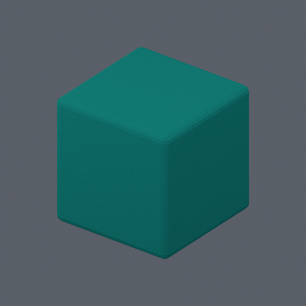
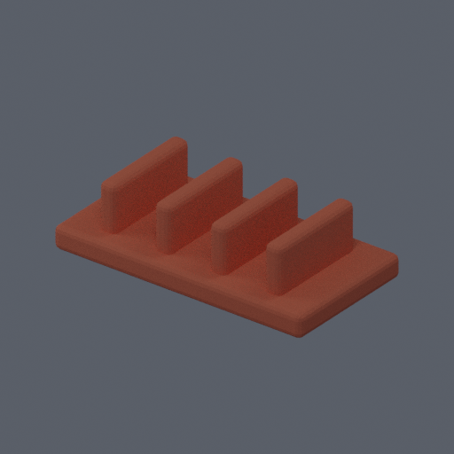
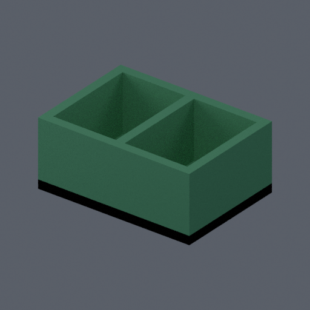

# Blender Chat Studio

🇧🇷 [Leia este README em Português (Brasil)](README.pt-BR.md).

[](https://github.com/santosgus3dtech/blender-chat-studio/actions/workflows/ci.yml)

A public, portfolio-safe foundation for conversational 3D modeling with Blender
and MCP. This first release publishes the real execution core, not a hosted AI
chat: an MCP client submits a complete scene, a restricted Linux worker runs
Blender, and validated artifacts return with geometry measurements and hashes.

**Status:** execution core available; standalone chat UI and public interactive
showcase are the next milestones. There is no public inference endpoint, bundled
account session, printer integration or automatic slicing.

## What works

- Local stdio MCP tools: `worker_health` and `execute_blender`.
- Conservative AST policy plus a separate, non-root, networkless Blender worker.
- Fresh scene per execution; bounded time, memory, processes and output size.
- GLB, STL, BLEND, PNG and JSON exports; complete-output validation and SHA-256 hashes.
- Three original deterministic scene scripts for reproducible examples.
- Provider-free tests and CI. No API key is needed for this release.

The examples are **authored scripts**, not proof of AI generation. Topology and
dimension checks do not certify mechanical strength, solid unions, tolerances or
physical printability. Multi-object examples deliberately expose this limitation.

## Original Examples

| Beveled cube | Cable guide | Desk organizer |
| --- | --- | --- |
|  |  |  |
| [GLB](examples/exports/beveled-cube/model.glb) / [STL](examples/exports/beveled-cube/model.stl) | [GLB](examples/exports/cable-guide/model.glb) / [STL](examples/exports/cable-guide/model.stl) | [GLB](examples/exports/desk-organizer/model.glb) / [STL](examples/exports/desk-organizer/model.stl) |

These are real Blender exports from the three included scripts, not screenshots
of a completed chat UI. Dimensions and limitations are recorded in
[verification](docs/VERIFICATION.md).

## Quick Start

Python 3.12+ and [uv](https://docs.astral.sh/uv/) are sufficient for syntax tests:

```sh
uv sync --locked --extra dev
uv run --locked pytest -q
uv run --locked blender-studio validate examples/beveled-cube.py
```

Actual generation requires Docker with **Linux containers**, including on Windows:

```sh
docker compose --profile tools build
docker compose up -d --wait worker
docker compose run --rm tools health
docker compose run --rm tools run examples/beveled-cube.py
docker compose run --rm tools run examples/cable-guide.py
docker compose run --rm tools run examples/desk-organizer.py
docker compose run --rm -T --entrypoint python tools -m studio.smoke
```

Results are written to the `exports` named volume under a new run UUID. They are
not written into your source directory. Copy explicitly selected results out with
`docker cp` from a retained tools container when needed. `docker compose stop`
stops this project's worker without deleting exports.

For a local MCP client, run the tools image through Compose with no published port:

```sh
docker compose run --rm -T --entrypoint blender-studio-mcp tools
```

Start the worker first. The MCP host supplies its own model/provider; this server
does not read `.env` files or connect to a model provider. Do not expose its
execution tools as an anonymous internet service.

## Architecture

```text
Trusted local MCP host or deterministic CLI
                |
     MCP stdio / execution adapter
                |
   size-bounded private Unix socket
                |
   networkless, read-only Linux worker
                |
     fresh background Blender process
                |
 GLB / STL / BLEND / PNG / geometry report
```

Scene coordinates, STL and reports use **millimeters**. GLB uses **meters**.
Syntax policy is defense in depth, not a Python sandbox. Container isolation is
mandatory for actual execution. See [security](SECURITY.md) and
[architecture](docs/ARCHITECTURE.md).

## Technology

Python, Blender/bpy, Model Context Protocol (MCP), asyncio, Docker Compose,
pytest, Ruff, uv and GitHub Actions. The planned chat/viewer will use React,
TypeScript and Three.js; those are not included in this first release.

## Roadmap

1. Add a public read-only chat replay, Three.js viewer and downloadable original examples.
2. Demonstrate initial creation, a requested revision and side-by-side comparison.
3. Add an explicitly configured local provider adapter, budgets, cancellation and version history.
4. Consider online generation only after authentication, quotas and isolated job execution are reviewed.

The operational edition remains separate. This repository starts with fresh Git
history and contains no operational data or account authentication flow.

## License

MIT for this repository's original code and example scripts. Blender and
dependencies retain their respective licenses; Blender is installed from Debian,
not copied into this repository. See [third-party notes](THIRD_PARTY_NOTICES.md).
